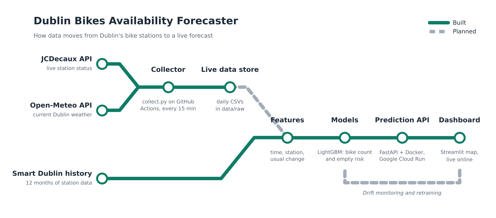
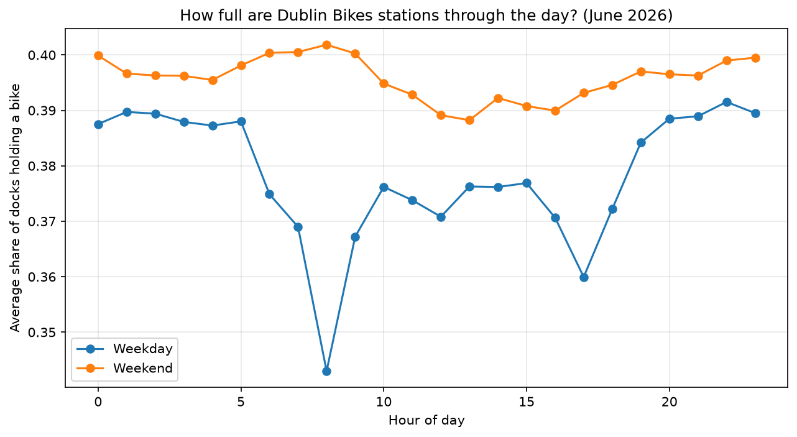
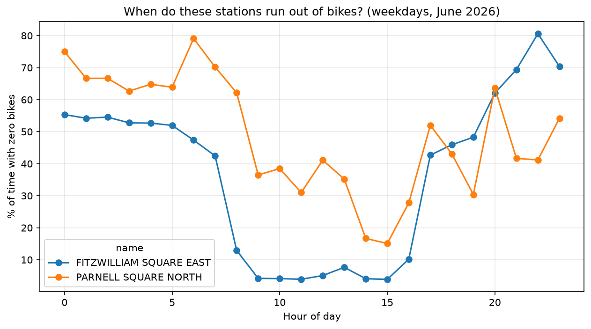
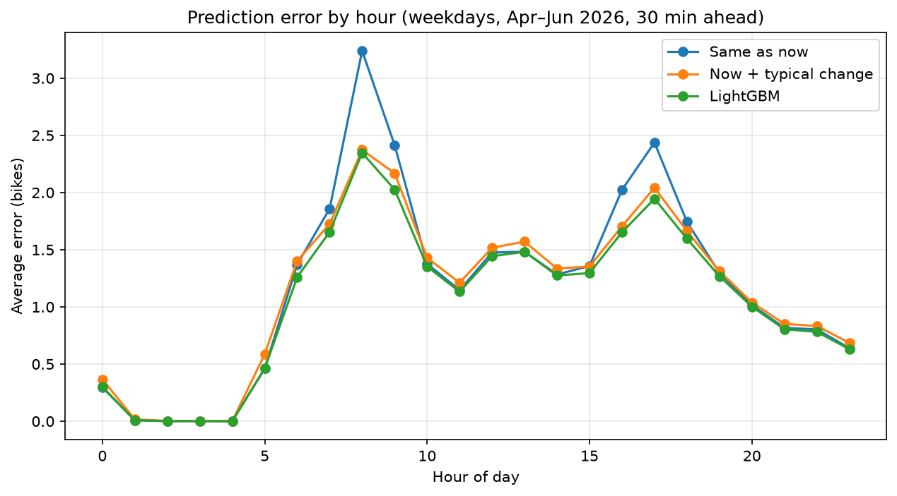
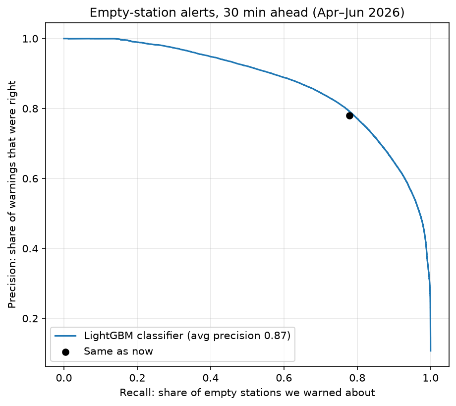

# 🚲 Dublin Bikes Availability Forecaster

**Predicting how many bikes a Dublin Bikes station will have in 30 minutes, and the risk that it runs out, using live data collected automatically every 15 minutes.**

**Live API:** [https://dublin-bikes-api-683472226763.europe-west1.run.app/docs](https://dublin-bikes-api-683472226763.europe-west1.run.app/docs) (the first request after a quiet period takes a few seconds while the server starts)

> 🚧 **Work in progress.** The data pipeline, both models and the prediction API are live. The map dashboard and automated retraining are in development (see [Roadmap](#roadmap)).

---

## The problem

Dublin Bikes has 115 stations across the city, but some of them are empty for a large share of the day. In June 2026, **Parnell Square North had zero bikes 47% of the time**, so a rider arriving there had close to a coin-flip chance of finding no bike.

Live apps show how many bikes a station has *right now*. This project predicts how many it will have *by the time you get there*, and how likely it is to be empty.

## What it does

- **Automated data collection:** a GitHub Actions workflow calls the JCDecaux Dublin Bikes API and the Open-Meteo weather API every 15 minutes and commits each snapshot to this repo.
- **Exploratory analysis:** 12 months of historical station data (July 2025 to June 2026, 7.1 million readings from 115 stations) cleaned and analysed.
- **Two LightGBM models:** one predicts the number of bikes in 30 minutes; the other predicts the probability that a station will be empty.
- **Prediction API:** a FastAPI service, packaged with Docker and deployed on Google Cloud Run, serves both models with live data.

## Architecture



Green lines show components that are built and running; grey dashed lines show planned components.

## Key findings

### 1. The weekday commute drives the whole network



On weekdays, average station fill drops sharply at **8 a.m.** and again at **5 p.m.**, when thousands of bikes are out on the road. Weekends stay almost flat, with only a mild midday dip. The same station at the same hour behaves very differently on a Tuesday than on a Sunday, so **hour of day and weekday/weekend are essential features**.

### 2. Stations differ in how reliably they recover



I expected northside residential stations and southside office stations to run empty at opposite times. The data only partly supported this:

- **Fitzwilliam Square East** (office area) fills almost completely every morning: it is empty under 10% of the time from 9 a.m. to 4 p.m., then empties quickly after 5 p.m.
- **Parnell Square North** is already empty 60–75% of the time at midnight, and only partially recovers during the day, in a much less predictable way.

Both stations are mostly empty at night. The real difference is how reliably they refill. Because each station has its own rhythm, **station identity needs to be a model feature**.

### 3. "Same as now" is a strong baseline

A station that is empty at 1 a.m. is almost always still empty at 1:30 a.m. Predicting "no change" therefore scores well overall, especially at night. Models are **evaluated hour by hour**, with a focus on rush hours (7–9 a.m. and 4–7 p.m.), when stations change fastest and simple guesses fail.

## Results: bikes in 30 minutes

Trained on Jul 2025–Feb 2026, validated on Mar 2026, tested on Apr–Jun 2026 (about 1 million unseen predictions).

| Method | Mean error (bikes) |
|---|---|
| Same as now | 1.06 |
| Historical average (station, weekday, hour) | 5.11 |
| Now + typical change for this station and hour | 1.03 |
| **LightGBM** | **0.97** |



- LightGBM beats every baseline overall and at every hour of the day.
- At the 8 a.m. peak, error falls from 3.24 bikes (same as now) to 2.35 (27% lower). Most of that gain comes from knowing which way each station usually moves at that hour.
- The historical average is far worse because a station's count carries over from earlier in the day: knowing the usual *level* doesn't help, but knowing the usual *change* does.
- Recent movement (change over the last 15–60 minutes) added surprisingly little, suggesting short-term station changes behave more like random arrivals than trends.

## Results: empty-station alerts

A second LightGBM model predicts the probability that a station will have **zero bikes in 30 minutes**.



| Method | Precision | Recall |
|---|---|---|
| Same as now | 78% | 78% |
| LightGBM classifier (threshold 0.41, chosen on March data) | 77% | 80% |

- Overall the classifier roughly matches the baseline, because most empty stations are already empty and easy to predict.
- The difference is **early warnings**. In the test months, stations with bikes ran out within 30 minutes 23,657 times. "Same as now" can never warn about these; the classifier warned about **22%** of them.
- Early warnings were correct **46%** of the time, compared with a base rate of **2.6%**: about 18× better than chance, but still less than half right. Predictions are therefore shown as a *risk level*, not a certainty.
- The threshold controls the trade-off: at 0.3 the model catches 40% of stations about to run out (39% of warnings correct); at 0.6 it catches 3% (57% correct).

## Prediction API

A FastAPI service serves both models with live data. It fetches current station status from JCDecaux (at most every 5 minutes), builds features with the same code used in training (`src/features.py`), and returns predictions as JSON.

| Endpoint | What it returns |
|---|---|
| `GET /forecast` | Predictions for every station |
| `GET /forecast/{station_id}` | Prediction for one station |
| `GET /health` | Service status and how much live data is in memory |

Example response:

```json
{
  "station_id": 21,
  "name": "LEINSTER STREET SOUTH",
  "capacity": 30,
  "bikes_now": 0,
  "bikes_in_30_min": 0,
  "empty_risk": 0.91,
  "empty_risk_level": "high"
}
```

`empty_risk_level` is `high` at or above the alert threshold chosen on validation data (0.41), `medium` from half that threshold, and `low` below.

The service is packaged with Docker and deployed on **Google Cloud Run** (europe-west1), which scales to zero when idle to stay within the free tier.

## Project structure

```
dublin-bikes-forecast/
├── .github/workflows/
│   └── collect.yml            # scheduled data collection (every 15 min)
├── api/
│   └── main.py                # FastAPI prediction service
├── data/
│   ├── raw/                   # live snapshots collected by the workflow
│   └── historical/            # monthly history files (downloaded locally, not committed)
├── images/                    # charts used in this README
├── models/                    # trained models, alert threshold, usual-behaviour table
├── notebooks/
│   ├── 01_explore.ipynb       # exploratory data analysis
│   ├── 02_baselines.ipynb     # baseline models
│   ├── 03_lightgbm.ipynb      # bike-count forecasting model
│   └── 04_empty_alert.ipynb   # empty-station alert classifier
├── src/
│   ├── collect.py             # fetches station status + weather
│   ├── download_history.py    # downloads and combines 12 months of history
│   └── features.py            # feature building, shared by training and the API
├── Dockerfile
├── requirements.txt           # everything (notebooks, training, API)
├── requirements-api.txt       # only what the API container needs
└── README.md
```

## Running it yourself

**Requirements:** Python 3.10+ and a free [JCDecaux API key](https://developer.jcdecaux.com/#/opendata/vls?page=getstarted). On macOS, LightGBM also needs `brew install libomp`.

```bash
git clone https://github.com/X2RSaM/dublin-bikes-forecast.git
cd dublin-bikes-forecast
python3 -m venv .venv
source .venv/bin/activate
pip install -r requirements.txt
export JCDECAUX_API_KEY=your_key_here
```

**Collect a live snapshot:**

```bash
python src/collect.py
```

**Download 12 months of history (about 1 GB):**

```bash
python src/download_history.py
```

**Run the API locally**, then open http://127.0.0.1:8000/docs:

```bash
uvicorn api.main:app --reload
```

**Run the API with Docker:**

```bash
docker build -t dublin-bikes-api .
docker run --rm -p 8000:8000 -e JCDECAUX_API_KEY=$JCDECAUX_API_KEY dublin-bikes-api
```

**Deploy to Google Cloud Run:**

```bash
gcloud run deploy dublin-bikes-api --source . --region europe-west1 \
  --allow-unauthenticated --memory 1Gi --max-instances 1 \
  --set-env-vars JCDECAUX_API_KEY=$JCDECAUX_API_KEY
```

To run the automated collection on your own fork, add your key as a repository secret named `JCDECAUX_API_KEY` (Settings → Secrets and variables → Actions) and set workflow permissions to "Read and write".

## Roadmap

- [x] Automated live data collection with GitHub Actions
- [x] Exploratory analysis of historical data
- [x] Download and combine 12 months of history
- [x] Baselines: "same as now", historical average, and "now + typical change"
- [x] LightGBM forecasting model (beats all baselines)
- [x] Hour-by-hour evaluation, focused on rush hours
- [x] Empty-station alert classifier with probability output
- [x] Prediction API (FastAPI + Docker), deployed on Google Cloud Run
- [ ] Interactive map dashboard (Streamlit), deployed online
- [ ] Experiment tracking with MLflow
- [ ] Weather features and 60-minute forecasts
- [ ] Data drift monitoring and automated retraining

## Data sources

- **Dublin Bikes station data:** Dublin City Council, via [Smart Dublin / data.gov.ie](https://data.gov.ie/en_GB/dataset/dublinbikes-api), licensed under [CC BY 4.0](https://creativecommons.org/licenses/by/4.0/). Live data from the [JCDecaux open data API](https://developer.jcdecaux.com/).
- **Weather data:** [Open-Meteo](https://open-meteo.com/), licensed under [CC BY 4.0](https://creativecommons.org/licenses/by/4.0/).

## Author

**Sourav Arun Mahajan**, MSc in Artificial Intelligence student, National College of Ireland, Dublin.
GitHub: [@X2RSaM](https://github.com/X2RSaM)
